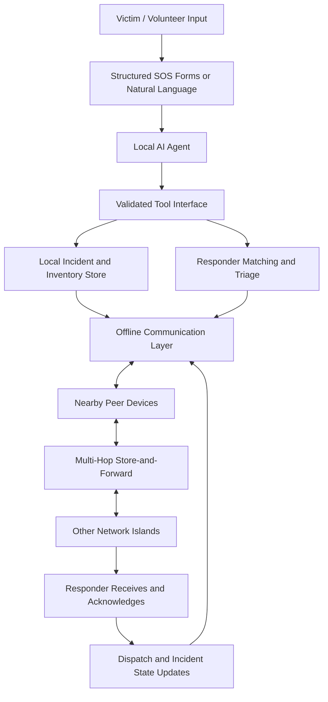

# CASCADE26 — Decentralised, AI-Assisted Emergency Response Network

> **A smartphone-first emergency coordination network that keeps working when internet access or central infrastructure is unavailable.**
>
> CASCADE combines offline peer-to-peer communication, tiny on-device AI agents, local resource coordination, and resilient message delivery to help victims, volunteers, and responders coordinate during disasters.

---

## Table of Contents

- [1. The Problem](#1-the-problem)
- [2. Our Proposed Solution](#2-our-proposed-solution)
- [3. Core Design Principles](#3-core-design-principles)
- [4. System Architecture](#4-system-architecture)
- [5. Local AI: Intelligence at the Edge](#5-local-ai-intelligence-at-the-edge)
- [6. Offline Communication Strategy](#6-offline-communication-strategy)
- [7. Emergency Message Protocol](#7-emergency-message-protocol)
- [8. Store-and-Forward Networking](#8-store-and-forward-networking)
- [9. Incident, Responder, and Inventory Coordination](#9-incident-responder-and-inventory-coordination)
- [10. Trust, Security, and Adversarial Resilience](#10-trust-security-and-adversarial-resilience)
- [11. Proposed Technology Stack](#11-proposed-technology-stack)
- [12. Development Roadmap](#12-development-roadmap)
- [13. Evaluation and Demonstration](#13-evaluation-and-demonstration)
- [14. Limitations and Open Questions](#14-limitations-and-open-questions)
- [15. Expected Impact](#15-expected-impact)

---

## 1. The Problem

During floods, earthquakes, fires, and other emergencies, communication infrastructure may become unavailable or unreliable:

- Cellular networks and internet connectivity may fail.
- Victims may be unable to contact emergency services.
- Responders have incomplete information about victims, skills, supplies, and hazards.
- Messages may be delayed, duplicated, or delivered out of order.
- Different groups may make conflicting decisions while disconnected.
- Malicious actors may spread false reports or impersonate responders.
- Centralised applications may stop functioning when their backend is unreachable.

A conventional emergency application that depends on a cloud server is not enough. Emergency coordination must continue using whatever devices and communication links remain available.

## 2. Our Proposed Solution

CASCADE is a **decentralised, smartphone-first emergency coordination system**. It allows devices to create, store, exchange, relay, and reconcile emergency information without requiring every device to remain connected to the internet.

The system combines four major capabilities:

1. **Offline communication:** Nearby devices exchange emergency records and relay them through other participating devices.
2. **Local AI agents:** Small models run directly on user devices, interpreting informal requests and invoking validated application tools without a cloud AI service.
3. **Resource coordination:** The system matches victims with responders, skills, supplies, and feasible routes.
4. **Trust and resilience:** The protocol handles duplicate messages, stale information, network partitions, conflicting assignments, and suspicious activity.

### Example Scenario

A victim reports:

> “We’re trapped on the first floor. The water is rising, my father needs medical assistance, and we need a boat.”

CASCADE aims to:

1. Extract the reported needs, hazards, and location information.
2. Create a structured emergency record.
3. Store the record locally and attempt delivery over available peer-to-peer links.
4. Relay the message through other devices if no direct path to a responder exists.
5. Identify responders with suitable skills, equipment, and availability.
6. Check reported inventory and available transport.
7. Rank feasible candidates using urgency, capability, route risk, and data confidence.
8. Request responder acceptance and track acknowledgement and arrival.
9. Reconcile conflicting updates when disconnected groups reconnect.

The AI helps interpret and coordinate information; deterministic software validates actions and enforces safety constraints.

## 3. Core Design Principles

- **Offline-first:** The system must remain useful without internet access.
- **AI at the edge:** Natural-language understanding and tool selection should be possible on the user's device.
- **No mandatory central server:** Local incident handling, message storage, and core decisions must not depend on a cloud backend.
- **Smartphone-first:** The initial implementation should use existing smartphone hardware rather than requiring external antennas or dedicated radios.
- **Transport-independent protocol:** The same message format should work over different supported transports.
- **Store-and-forward:** Messages must survive temporary disconnections and app restarts.
- **Human oversight:** Critical dispatches and medical actions must not rely on unverified model output.
- **Privacy by design:** Sensitive medical and location data should be minimised and protected.
- **Graceful degradation:** Devices without an AI runtime should still be able to send, receive, and relay structured emergency messages.

## 4. System Architecture



### Main components

| Component | Responsibility |
|---|---|
| User interface | SOS reporting, responder status, inventory updates, dispatch decisions |
| Local AI agent | Interpret free text, extract fields, choose tools, identify ambiguity |
| Tool execution layer | Validate arguments and permissions; perform controlled application operations |
| Local database | Store incidents, inventory, responder profiles, messages, and event history |
| Communication adapter | Discover peers and transfer data using supported phone-to-phone transports |
| Relay protocol | Forward messages, suppress duplicates, apply expiry and retry policies |
| Coordination engine | Triage incidents, match responders, check supplies, and propose assignments |
| Trust and security layer | Authenticate messages, track provenance, detect suspicious behaviour, protect sensitive data |
| Evaluation simulator | Reproduce network failures, malicious nodes, stale data, and competing assignments |

## 5. Local AI: Intelligence at the Edge

Local AI is a **central selling point of CASCADE**, not merely an optional chatbot feature.

Instead of sending sensitive emergency descriptions to a cloud model, each compatible phone can run a small model locally. The model interprets the message and requests application tools using structured arguments. This allows natural-language assistance to remain available even when internet connectivity is completely unavailable.

### Why local AI matters

- **No cloud dependency:** The model can operate during internet outages.
- **Low communication overhead:** The system transmits compact structured records rather than requiring every recipient to run a large model.
- **Privacy:** Sensitive reports can be interpreted on-device without sending their raw text to an external AI service.
- **Low resource requirements:** A compact model can be selected to suit lower-powered devices.
- **Resilience:** Each participating AI-capable device can independently interpret reports and query its local data.
- **Flexible input:** People can describe an emergency in ordinary language instead of navigating a long form.

### Candidate model: Needle 2

Needle 2 is an initial candidate because it is designed for lightweight on-device function calling and structured extraction. Other candidates worth benchmarking include FunctionGemma 270M, LFM2.5-350M, and Qwen3 0.6B.

Model choice should be based on measured performance on target phones, not parameter count alone. We should evaluate:

- End-to-end time from message receipt to valid incident record.
- Tool-selection accuracy.
- Field-extraction accuracy.
- Handling of ambiguous or incomplete messages.
- RAM usage, model size, and battery consumption.
- Robustness to misspellings and target-language/code-mixed input.

### Example AI workflow

Input:

> “Water is coming upstairs. Need medical help and a boat. My dad needs insulin.”

The local model may extract:

```json
{
  "reported_needs": ["medical_assistance", "insulin", "boat"],
  "reported_hazards": ["flooding"],
  "urgency_assessment": "potentially_critical",
  "requires_clarification": true,
  "verification_status": "unverified"
}
```

This is an illustrative extraction, not a medical diagnosis or a verified incident.

### Tool calling

The model can request typed tools such as:

- `report_emergency()`
- `check_inventory()`
- `find_responder()`
- `score_dispatch_candidates()`
- `propose_dispatch()`
- `accept_dispatch()`
- `confirm_arrival()`
- `report_duplicate()`

The application—not the language model—executes database operations and enforces permissions, quantity constraints, and safety rules.

For example, the model may request `check_inventory("insulin")`. The inventory engine returns the locally recorded stock, its last update, and its verification status. The model must not invent stock quantities or claim that an unverified supply is available.

### Graceful degradation

Local AI is a key capability, but it must not become a single point of failure. A device without a compatible model can still use structured SOS buttons, relay messages, acknowledge receipt, and store updates. Deterministic logic handles essential operations when inference is unavailable.

## 6. Offline Communication Strategy

The initial constraint is to use existing smartphones without requiring external antennas, dedicated radio devices, or a mandatory hotspot.

### Candidate transports

| Transport | Internet required? | Best role | Important limitation |
|---|---|---|---|
| Bluetooth Low Energy | No | Discovery and compact messages | Short range; multi-hop forwarding must be implemented |
| Wi-Fi Direct | No | Higher-throughput direct transfer | Platform support varies; no automatic general-purpose mesh |
| Google Nearby Connections | No | Practical Android peer discovery, connections, and data exchange | Does not automatically provide the full multi-hop relay protocol |
| Local Wi-Fi / hotspot | Not for local traffic | Local clusters and bulk synchronisation | A hotspot is not a complete mesh and may become a single point of failure |
| SMS | Carrier-dependent | Fallback when cellular service remains available | Fails when carrier infrastructure is unavailable |
| Cellular data | Yes, for ordinary cloud services | Additional delivery path when available | Cannot be assumed during an outage |
| Satellite messaging | Service/device-dependent | Possible external fallback on supported devices | Not universally available or free for ordinary smartphone apps |
| LoRa radio | No | Long-range, low-bandwidth messaging | Requires additional radio hardware, outside the initial constraint |

### Preferred starting point

Use **Android peer-to-peer communication with Google Nearby Connections**, subject to validation on target devices. It provides a practical interface for nearby device discovery and data transfer without requiring internet connectivity.

The application must implement the features that make this useful as an emergency mesh:

- Multi-hop forwarding.
- Persistent outbound message queues.
- Duplicate suppression.
- Expiry and retry policies.
- Acknowledgements and delivery state.
- Network partition detection and recovery.
- Event reconciliation after reconnection.

### Critical limitation

Ordinary smartphone radios cannot guarantee city-wide delivery when all infrastructure is unavailable. Messages can travel across connected chains of phones, or be carried by people who later encounter other peers, but a sparse network may not have a usable path at the required time.

Background scanning and connectivity also depend on operating-system restrictions, device capabilities, battery state, and user permissions. These behaviours must be tested on physical devices.

## 7. Emergency Message Protocol

JSON is the initial human-readable format for incident messages.

Example:

```json
{
  "message_id": "req-1042",
  "type": "EMERGENCY_REQUEST",
  "created_at": 1792900800,
  "expires_at": 1792904400,
  "origin_id": "device-104",
  "priority": "CRITICAL",
  "payload": {
    "need": "medical_assistance",
    "location": {
      "lat": 19.076,
      "lon": 72.877,
      "accuracy_m": 100
    },
    "hazards": ["flooding"],
    "description": "Person trapped on first floor"
  }
}
```

The production protocol should define:

- Stable message and event identifiers.
- Message types and schema versions.
- Creation times, expiry, and freshness rules.
- Origin identity or pseudonymous identity.
- Payload validation.
- Authentication and integrity protection.
- Encryption for sensitive contents.
- Acknowledgement and retry semantics.
- Size limits and hop limits.
- Conflict-resolution rules.

### Store-and-forward workflow

1. Create and persist the message locally.
2. Discover a compatible peer.
3. Transfer the message.
4. Validate its structure and authenticity.
5. Store it if it has not already been processed.
6. Acknowledge receipt.
7. Relay it when appropriate.
8. Retry eligible messages after failed connections.
9. Reconcile updates and conflicts when network partitions heal.

Large records and attachments should not be sent unnecessarily. Compact emergency messages are better suited to unreliable, low-throughput links.

## 8. Incident, Responder, and Inventory Coordination

The system should maintain local records of victims' needs, hazards, responder skills, availability, equipment, supplies, and dispatch history.

### Candidate operations

| Function | Purpose |
|---|---|
| `report_emergency()` | Create a provisional incident |
| `check_inventory()` | Read local stock and its freshness |
| `reserve_inventory()` | Attempt an atomic reservation |
| `find_responder()` | Search reported skills and availability |
| `estimate_hazard_risk()` | Evaluate known route hazards |
| `score_dispatch_candidates()` | Rank feasible assignments |
| `propose_dispatch()` | Create a proposed assignment |
| `accept_dispatch()` | Record responder acceptance |
| `confirm_arrival()` | Record confirmed arrival |
| `report_duplicate()` | Link potentially duplicate incidents |

### Dispatch principles

- Apply hard safety constraints before ranking candidates.
- Consider urgency, capability, availability, stock, travel cost, and hazard risk.
- Distinguish reported claims from verified facts.
- Track location freshness and uncertainty.
- Require clear acceptance and assignment states.
- Prevent stale updates from silently cancelling completed actions.
- Resolve conflicting assignments after disconnected devices reconnect.

### Inventory state

Stock should be classified as:

- Reported.
- Verified.
- Reserved.
- Delivered.
- Unknown or stale.

Disconnected devices may independently reserve the same stock. The system must detect and escalate these conflicts rather than assuming that local reservations are globally exclusive.

## 9. Trust, Security, and Adversarial Resilience

The system must remain robust against both unreliable information and malicious participants.

| Threat | Defence |
|---|---|
| Fake emergency reports | Rate limits, deduplication, corroboration, bounded resource commitments |
| Sybil attacks | Identity controls, per-identity limits, verified credentials where available |
| Location spoofing | Accuracy and freshness metadata, plausibility checks, corroboration |
| Replay attacks | Unique IDs, expiry, sequence/version tracking |
| Battery exhaustion | Scanning backoff, quotas, payload limits, hop limits |
| Malicious relays | Message authentication, acknowledgements, alternative routes |
| Conflicting assignments | Explicit state transitions, event history, conflict reconciliation |
| Privacy exposure | End-to-end encryption and minimised routing metadata |

A cryptographic signature proves possession of a key, not that a person is a qualified responder. Trust must reflect evidence and credential verification, not simply whether a message is signed.

An unverified emergency should not automatically receive low priority. Urgency and confidence are separate dimensions.

## 10. Proposed Technology Stack

| Layer | Initial choice |
|---|---|
| Mobile application | Native Android or React Native with native networking integration |
| Peer communication | Google Nearby Connections, subject to compatibility testing |
| Message format | Versioned JSON |
| Local storage | SQLite |
| Relay protocol | Application-level store-and-forward |
| On-device AI | Needle 2 as an initial candidate; benchmark alternatives |
| Tool execution | Typed application functions and strict validation |
| Matching and triage | Deterministic algorithms initially |
| Evaluation | Python-based network simulator and physical Android devices |

A central FastAPI service may help during development, but it must not be required for the deployed system's essential offline workflows.

A browser-only prototype is useful for simulation, but native mobile networking is preferable for testing real device discovery and background behaviour.

## 11. Development Roadmap

### Phase 1 — Define the protocol

- Finalise message schemas, IDs, expiry, authentication, and acknowledgement states.
- Define incident, responder, inventory, and assignment records.
- Build deterministic validation and matching functions.

### Phase 2 — Prove direct offline communication

- Connect two Android devices.
- Exchange JSON with internet access disabled.
- Verify persistence, delivery acknowledgement, and recovery after disconnection.

### Phase 3 — Implement multi-hop delivery

- Add a third device.
- Implement forwarding, duplicate suppression, hop limits, expiry, and retry policies.
- Test messages moving through intermediate devices.

### Phase 4 — Integrate local AI

- Package a small model for on-device inference.
- Evaluate structured extraction and tool-selection accuracy.
- Test ambiguous messages, misspellings, and relevant languages.
- Ensure the core workflow continues if inference fails.

### Phase 5 — Add coordination and resilience

- Implement inventory operations, candidate matching, and dispatch state transitions.
- Simulate network partitions and conflicting reservations.
- Add adversarial scenarios and privacy protections.

### Phase 6 — Evaluate the complete system

- Run repeatable scenarios with multiple victims, responders, and constrained supplies.
- Measure performance and compare the system against a baseline.
- Document limitations and demonstrate failure recovery.

## 12. Evaluation and Demonstration

The demonstration should prove that the system works without a central server and explain how it behaves under failures.

Suggested metrics:

- Message delivery success rate.
- Median and 95th-percentile delivery latency.
- AI extraction and tool-selection accuracy.
- Duplicate dispatch rate.
- Unsafe assignment rate.
- Resource-allocation quality and fairness.
- Battery consumption.
- Time to recover after a network partition.
- Conflict detection and reconciliation success.

### Proposed demonstration

1. A victim submits an informal emergency report.
2. The local AI extracts structured facts and requests appropriate tools.
3. The application validates the record and saves it locally.
4. The message is sent to a second phone without internet.
5. A third phone relays the request to a responder.
6. The responder checks supplies and accepts a proposed assignment.
7. The network partitions and competing updates are generated.
8. A malicious node injects a fake or duplicate report.
9. The devices reconnect and reconcile state without silently overwriting important events.

Benchmark values should be measured, not invented.

## 13. Limitations and Open Questions

The following remain important design decisions:

- Should we implement our own relay protocol or reuse an existing open-source implementation such as Knit?
- Is Android-first sufficient, or is cross-platform support mandatory?
- How reliably can the chosen transport operate with the screen locked or the app in the background?
- How should the system handle sparsely populated areas without a connected chain of smartphones?
- Which model performs best on actual target phones and relevant languages?
- Which coordination functions must be implemented for the first demo versus simulated?

The largest physical limitation is long-range delivery. With no internet, no satellite service, no dedicated radios, and no sufficiently connected chain of smartphones, software alone cannot guarantee delivery over arbitrary distances.

## 14. Expected Impact

CASCADE aims to demonstrate how decentralised communication and on-device intelligence can support emergency coordination when conventional infrastructure is unreliable.

Its differentiating features are:

- **Local AI:** Understand emergency requests and invoke application tools without a cloud AI dependency.
- **Offline-first messaging:** Preserve and relay reports across temporary disconnections.
- **Decentralised coordination:** Maintain useful local incident and resource information.
- **Trust-aware decisions:** Distinguish reported claims from verified evidence.
- **Resilient dispatch:** Handle conflicting updates, limited resources, and changing hazards.
- **Graceful degradation:** Keep basic emergency messaging available even on devices without local AI.

The central thesis is that emergency coordination should not fail simply because a central server is unreachable. By combining compact on-device intelligence with resilient peer-to-peer communication and explicit safety controls, CASCADE seeks to make emergency information more useful, available, and actionable under adverse conditions.

---

## Project Status

**Current direction:** Smartphone-first offline emergency coordination with local AI as a core feature.

**Preferred communication starting point:** Android peer-to-peer communication using Nearby Connections, with a custom store-and-forward layer.

**Primary AI candidate:** Needle 2, to be evaluated against other compact on-device models.

**Next milestone:** Deliver a working two-device offline JSON exchange, then extend it to multi-hop relay and integrate the local AI workflow.
